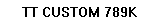

# 작업표시줄 원인 분석 및 1~5단계 후속 검증

일자: 2026-10-20. 승인 범위: 작업표시줄 원인 분석, 문제없는 범위에서 표시·복구·제공자 수집 검증과 기본값 정리까지 진행. 제품 앱 구현·AICap 변경·Explorer 종료·재부팅은 수행하지 않았다. 별도 시험 창과 검증 스크립트만 사용했다.

## 1. 원인 분석 결과

현재 Windows 11 Pro 25H2 build 26200.9711, 1920×1080 주 화면, 작업표시줄 DPI 96에서 **일반 자식 창의 그리기가 실제 작업표시줄 화면에 나타나지 않는 현상**을 재현했다. 동일 사용자 정의 그리기 코드에서 WS_EX_LAYERED + SetLayeredWindowAttributes(alpha=255)를 적용한 시험만 실제 숫자가 표시됐다.

따라서 이번 최소 시험 실패는 잘못된 숫자 문자열·좌표·창 연결 자체보다, 작업표시줄 아래 일반 자식 창의 표시/합성 방식에 원인이 있다는 근거를 확보했다. 모든 Windows 빌드에서 layered만이 해법이라는 결론이나 AICap 사용자 증상의 원인으로 확대하지 않는다. Explorer/DWM 내부의 정확한 그리기 폐기 경로까지 추적한 것은 아니다.

| 조사 | 관찰 | 판단 |
|---|---|---|
| 작업표시줄 밖 동일 STATIC 대조군 | `TT CTRL 456K` 실제 표시 | 글자·기본 STATIC 그리기와 캡처가 전혀 작동하지 않는 문제는 아님 |
| 작업표시줄 좌표 | (0,1032)~(1920,1080), client 원점 (0,1032) | 화면/클라이언트 좌표 확인 |
| 시험 창 좌표 | (8,1036)~(168,1060) | 작업표시줄 영역 안에 있음 |
| 부모/표시/스레드 | 부모 일치, WS_VISIBLE, 소유 스레드=검사 스레드 | 잘못된 부모·다른 스레드 메시지 큐 가설을 뒷받침하지 않음 |
| 가려진 상태 | DWM cloaked=0, 시험 창이 직접 자식 Z-order 0 | 단순 cloaked/형제 Z-order 하단 문제로 단정할 근거 없음 |
| 메시지 처리 | 추가 Pump 후에도 숫자 미표시 | 대기만 늘려 해결되지 않음 |
| STATIC PrintWindow | false, 빈 이미지 | 해당 캡처 방식 실패. 이것만으로 모든 WM_PAINT 실패를 증명하지 않음 |
| 사용자 정의 클래스, 일반 | WM_PAINT 1회, 숫자 미표시 | STATIC 클래스만의 문제는 아님 |
| 같은 클래스, CS_PARENTDC만 추가 | WM_PAINT 1회, 숫자 미표시 | CS_PARENTDC 제거만으로 해결되지 않음 |
| 같은 클래스, WS_EX_LAYERED + alpha=255 | WM_PAINT 1회, 숫자 실제 표시 | 현재 시험에서 화면 합성 방식 차이가 결과를 바꿈 |

[WindowFromPoint 공식 문서](https://learn.microsoft.com/en-us/windows/win32/api/winuser/nf-winuser-windowfrompoint)에 따라 STATIC 컨트롤 아래 창을 반환할 수 있으므로, 반환값이 Shell_TrayWnd였다는 사실을 가림의 확정 근거로 쓰지 않는다. 빈 clipping 영역도 관측되지 않았다. Shell에 Windows.UI.Composition.DesktopWindowContentBridge가 있다는 점은 환경 정보이며 그 창이 원인이라고 단정하지 않는다.

공식 문서와의 연결: [IsWindowVisible](https://learn.microsoft.com/en-us/windows/win32/api/winuser/nf-winuser-iswindowvisible)은 표시 스타일과 실제 가시성이 다름을 설명한다. [Layered Windows](https://learn.microsoft.com/en-us/windows/win32/winmsg/window-features#layered-windows)는 layered 그리기를 별도 메모리로 리다이렉트하여 합성하는 동작과 child window 지원을 설명한다. 이는 이번 A/B 결과의 해석 근거이며 Shell 내부 자식 삽입의 장기 안정성을 보장하지 않는다.

## 2. 최소 표시 시험

두 시험은 부모·위치·크기·문구·WM_PAINT 코드를 동일하게 두었다. layered 사용 시 확장 스타일과 alpha 초기화만 추가했다. 실제 셸 연결 상태에서 숫자 표시의 기술적 가능성은 확인했다.

단, 좌표 (8,4)는 원인 비교용 고정 좌표다. 기존 Windows 기능 점유 공간 회피, 마우스/키보드 조작, 스타일, Tauri/WebView 통합은 검증하지 않았다. 이 시험을 F-09 완성으로 처리하지 않는다. 채택 후보는 독립 그리기 표면을 가진 native layered child이며 전체 제품 설계에서 레이아웃/입력/접근성 검토가 필요하다.

## 3. 복구 시험

[taskbar-recovery-probe.ps1](taskbar-recovery-probe.ps1)은 시험 창이 유실되면 재생성하며 부모 탐색 불가 시 표시 생성을 기다리는 최소 루프다.

| 단계 | 관측 시간 | 결과 |
|---|---:|---|
| 최초 연결 | 시작 후 334ms | 숫자 표시 |
| 자기 시험 창 강제 제거 | 3,094ms | 다음 확인에서 유실 감지 |
| 시험 창 재연결 | 3,283ms | 189ms 뒤 재표시 |
| 부모 탐색 불가 모의 시작 | 6,536ms | 자기 창 제거, 실제 Explorer는 그대로 유지 |
| 탐색 복구 후 재연결 | 8,679ms | 8,500ms 이후 복구 가능 조건에서 재표시 |

세 번의 [표시 이미지 1](evidence-2026-10-20/recovery-1.png), [2](evidence-2026-10-20/recovery-2.png), [3](evidence-2026-10-20/recovery-3.png)을 직접 확인했다. 시험 종료 후 창을 제거하고 DPI 문맥을 복원했다.

**모의 복구 통과이며 실제 Explorer 재시작 통과가 아니다.** 셸 프로세스/핸들 교체·메시지 브로드캐스트·실제 로그인·절전·DPI 전환은 추가 실환경 시험이 필요하다. 실제 셸을 재시작할 제품 후보가 아직 없고 고정 좌표 시험에는 충돌 회피도 없어, 이번 제한된 진단을 장기 상주나 복구 완료로 확대하지 않았다.

## 4. 제공자 검증 보완

### Claude

[claude-readonly-probe.mjs](claude-readonly-probe.mjs)를 `--quota`로 실행했다. 기존 Claude 로그인 정보로 OAuth usage GET 1회, HTTP 200. five_hour와 seven_day 모두 숫자 utilization과 파싱 가능한 resets_at 확인. 인증 파일은 조회 전후 해시 일치. 자체 refresh/설정 쓰기/모델 요청 없음. 다른 요금제·권한·만료 상황까지 검증한 것은 아니다.

### Codex

[codex-readonly-probe.mjs](codex-readonly-probe.mjs)의 로컬 기록 검증을 확장했다. 29개 파일에서 4,870개 token_count 레코드를 검사했고, 이 중 데스크톱 출처 10개 파일에 251개 레코드가 있었다. 실행 중 로그 증가 때문에 이전 보고서의 수와 다를 수 있다.

- 정수 카운터가 있는 4,870개에서 input_tokens + output_tokens = total_tokens 불일치 0건.
- cached_input_tokens > input_tokens 0건, reasoning_output_tokens > output_tokens 0건.
- 파일 내 연속된 동일 누적 스냅샷 168건, 누적 총량 감소 0건.

168건은 중복 청구 건수가 아니다. 같은 누적 스냅샷 반복을 독립 소비량으로 더하면 안 된다는 파서 설계 근거다. 캐시·추론을 전체 입력/출력 위에 다시 더해서도 안 된다. cache_write의 보편적 의미, fork/archive 간 동일성, 완성된 제품 파서의 재시작·중복 처리·정확한 합계는 별도 검증이다. 이번에는 새 제품 파서를 만든 것이 아니라 실제 기록의 수치 계약을 감사했다.

### Gemini CLI

[gemini-reference-fixtures.mjs](gemini-reference-fixtures.mjs)는 CodeBurn 0.9.27의 src/quota/gemini.ts 및 security.ts를 임시 위치에서 TypeScript 타입만 제거해 실행했다. 원본 소스를 수정하거나 의존성을 설치하지 않았다. credential read와 fetch는 모두 합성 자료로 주입했고 실제 네트워크 fallback은 실패하도록 차단했다.

통과 사례 5개: 잔여 비율/초기화 변환, 잘못된 버킷 제외, loadCodeAssist→retrieveUserQuota와 project 전달, 429 Retry-After, 인증 부재 시 요청 없음.

이는 **참고 구현의 모의 응답 검증**이다. TokenTrailer 구현 시험도, 실제 Google 계정 조회 성공도 아니다. Gemini CLI 지원 목표와 실제 한도 조회 출시 조건은 유지하며 계정 유형별 실제 조회는 별도 시험 환경에서 검증해야 한다.

## 5. 기본 설정 정리

사용자 답변: 한도 갱신을 AICap처럼 선택할 수 있게 하고 참고 가능한 기본 설정을 가져오고자 함. [설정 검토 목록](../../../.kiro/specs/desktop-presence/settings-review.md)에 반영했다.

한도 주기 선택 기능은 승인 반영. 5/15/30/60/300초 선택과 기본 300초, 연결별 설정은 AICap 선례에 따른 구체안이다. 서버 Retry-After가 우선하며 UI 캐시 표시 주기와 외부 API 주기를 분리한다. 다른 기본값 제안까지 일괄 승인된 것으로 처리하지 않았다.

## 단계별 상태

| 단계 | 상태 |
|---|---|
| 1 원인 분석 | 현재 최소 시험에서 일반/독립 합성 표면 차이로 원인 영역 확인. Explorer 내부 메커니즘/AICap 원인까지 확정한 것은 아님 |
| 2 표시 시험 | 최소 직접 표시 성공. 제품 배치·상호작용 미검증 |
| 3 복구 | 창 유실·탐색 불가 모의 복구 성공. 실제 셸/로그인/절전/DPI 시험 미완료 |
| 4 제공자 검증 | Claude 실조회, Codex 실제 기록 수치 감사, Gemini 참고 구현 fixture 통과. 전체 요금제/제품 파서 완료 아님 |
| 5 기본값 | 갱신 선택 요구 반영, AICap 설정의 채택/보류 목록 작성. 나머지 제안값 검토 필요 |

원본 초기 probe와 제품 요구를 몰래 대체하지 않았다. [초기 검증](2026-10-20-feasibility.md)의 미표시 결과는 당시 결과로 유지하며, 현재 후속 근거를 연결했다. 제품 구현·셸 설정 변경·커밋·배포는 하지 않았다.

근거: [진단 JSON](evidence-2026-10-20/result.json), [복구 JSON](evidence-2026-10-20/recovery-result.json), [진단 스크립트](taskbar-diagnostic-probe.ps1). JSON과 화면 캡처는 비밀정보·대화 원문 없이 시험 표면에 한정했다.
